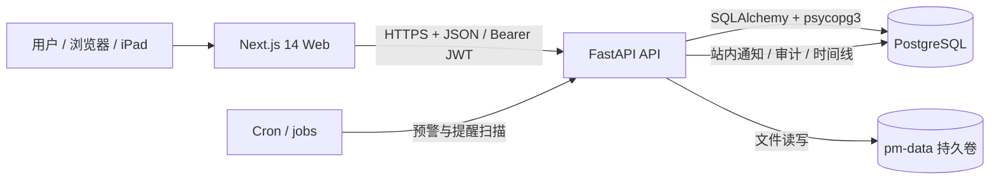
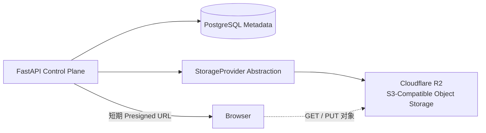
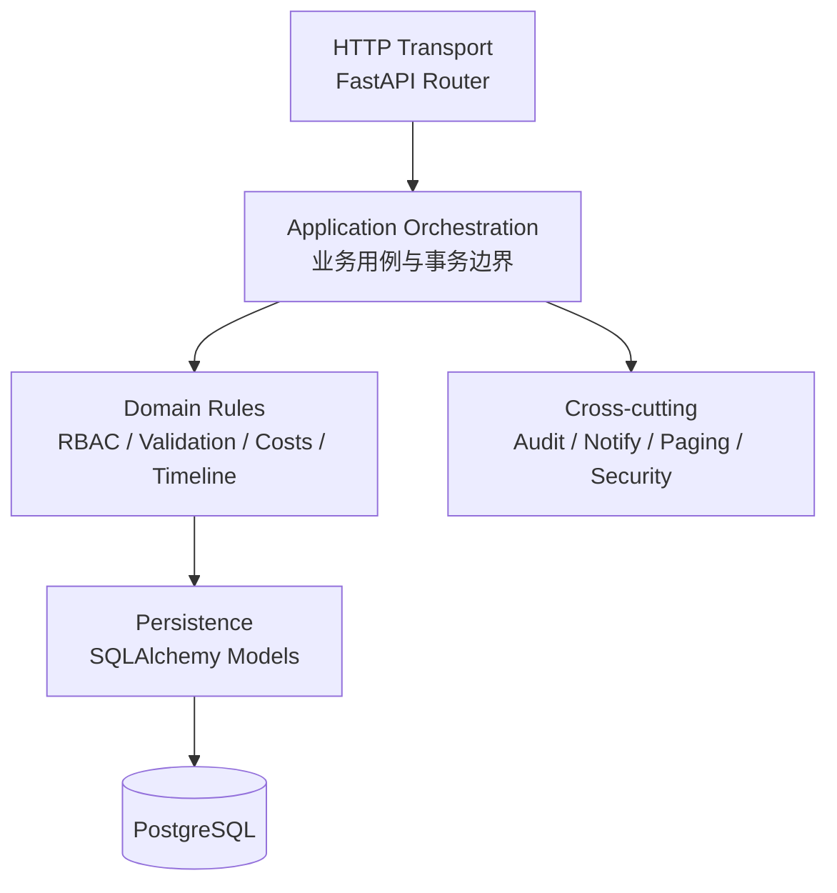
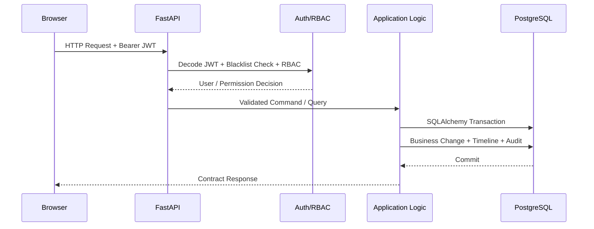
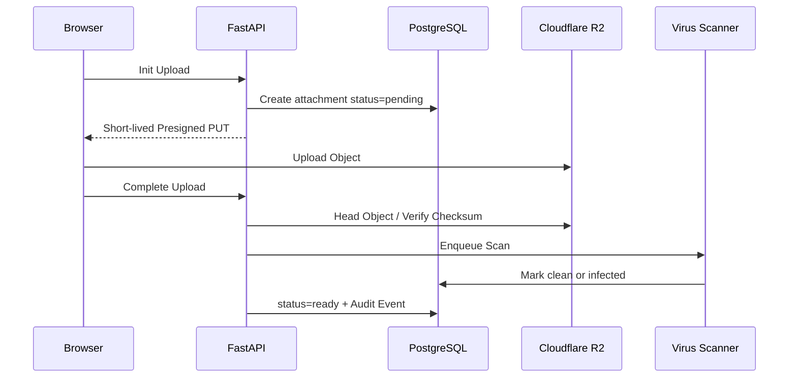
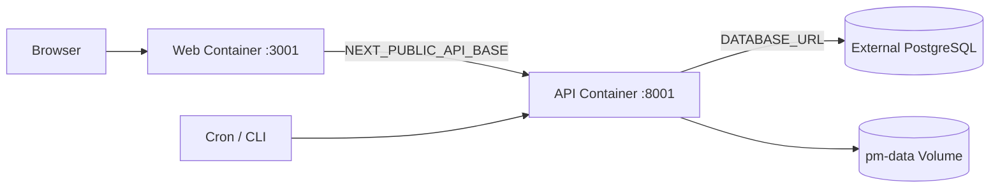
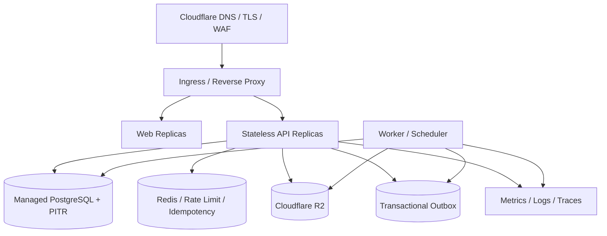

# 数科云办公：系统架构设计

> 文档状态：Architecture Baseline v1.0<br>
> 更新时间：2026-09-17<br>
> 标记约定：`[现状]` 表示代码已实现；`[目标]` 表示推荐的目标架构或演进方向，不代表当前已经落地。

数科云办公是一套面向企业内部项目治理的数字化工作台，覆盖组织与账号、项目台账、进度任务、成本支出、审批、通知、报表、通讯录和安全审计。系统当前采用 **API-first 的分层模块化单体**，以 PostgreSQL 作为唯一业务系统记录，通过事务一致性、显式权限边界和审计留痕保证管理数据的可信度，并为后续对象存储、水平扩容和安全增强保留演进路径。

---

## 1. 架构定位

### 1.1 架构范式

- **API-first**：前端、批处理任务和未来的第三方系统统一通过 `/api/v1` 契约访问业务能力。
- **Layered Modular Monolith**：当前不拆微服务，按身份、项目、进度、成本、审批、通知、通讯录、审计等限界上下文组织模块，降低分布式事务与跨服务治理成本。
- **Transactional Consistency**：关键业务变更、审批时间线、通知和审计记录尽量落在同一事务边界内。
- **System of Record**：PostgreSQL 是业务事实源；文件对象、通知和报表均是围绕该事实源构建的数据面或派生产物。
- **Control Plane / Data Plane Separation** `[目标]`：数据库保存附件元数据和权限决策，Cloudflare R2（S3-compatible API）保存二进制对象；API 负责控制面，对象存储负责数据面。
- **Incremental Evolution**：优先偿还一致性、安全和可观测性债务，再根据真实负载拆分服务，不提前引入无收益的分布式复杂度。

### 1.2 领域边界

| 领域 | 核心职责 | 主要模块 |
| --- | --- | --- |
| 身份与访问 | 登录、会话、密码策略、RBAC、项目管理边界 | `auth`、`meta`、`admin`、`core.rbac` |
| 组织与通讯录 | 部门、账号主数据、员工档案、证件与合同附件 | `contacts` |
| 项目治理 | 项目生命周期、成员、合同、附件、跟进记录 | `projects` |
| 计划与执行 | WBS、任务依赖、里程碑、进度填报、预警 | `tasks`、`milestones`、`core.jobs` |
| 成本与预算 | 预算、调整、支出、凭证、执行率、超预算控制 | `budgets`、`expenses`、`core.costs` |
| 审批与流程 | 立项、预算调整、支出审批、状态时间线 | `approvals`、`core.timeline` |
| 通知与协作 | 站内通知、去重、处理状态、深链定位 | `notifications`、`core.notify` |
| 报表与决策 | 成本、部门、项目、月份聚合和 Excel 导出 | `reports`、`dashboard` |
| 安全与审计 | 权限拒绝、敏感操作留痕、业务时间线、审计查询 | `core.audit`、`core.timeline`、`admin` |

### 1.3 C4 Container View `[现状]`



### 1.4 目标数据面



---

## 2. 前端架构

### 2.1 技术栈与运行时

- `[现状]` Next.js 14 App Router、React 18、TypeScript、Recharts。
- `[现状]` `/login`、`/change-password` 与 `(dashboard)` 路由组构成两套页面壳；业务页面按领域拆分为 projects、progress、costs、approvals、reports、contacts、admin。
- `[现状]` Next.js Middleware 只承担粗粒度路由门禁和登录页重定向；它不替代后端鉴权，真正的权限边界始终在 FastAPI。
- `[现状]` 前端通过统一 API Client 注入访问令牌、处理 `401`、传播 `AbortController`、解析业务错误和下载二进制流。

### 2.2 前端分层

| 层 | 职责 | 典型实现 |
| --- | --- | --- |
| Route / Composition | 页面编排、路由参数、权限态加载 | `app/(dashboard)/**/page.tsx` |
| Feature UI | 业务弹窗、抽屉、筛选、表格和操作反馈 | `*Dialog`、`*Drawer`、Feature Page |
| Shared UI | 按钮、字段、分页、Toast、导航壳 | `components/ui/*` |
| State / Data Access | URL 状态、请求并发与取消、元数据缓存 | `useUrlState`、`useAsyncData`、`useMeta` |
| Contract Client | API 基址、令牌、错误语义、类型模型 | `lib/api.ts` |

### 2.3 前端状态模型

- **URL 是列表上下文的事实源**：筛选、分页、当前项目、详情目标写入查询参数，支持刷新恢复、深链和浏览器前进后退。
- **服务端状态按需获取**：页面通过 feature API 获取数据，使用 `AbortController` 取消过期请求，避免筛选快速切换时出现响应乱序。
- **全局状态保持最小化**：当前只缓存当前用户、菜单、用户和部门字典；业务数据不复制到全局 Store。
- **权限展示来自服务端契约**：菜单和 `is_super_admin`、`can_approve` 由 `/meta/me/menus` 下发，`is_admin` 仅为同义兼容字段；前端不硬编码管理菜单，不通过隐藏按钮充当安全边界。

### 2.4 前端安全问题与目标架构

| 事项 | `[现状]` | `[目标]` |
| --- | --- | --- |
| 会话载体 | localStorage + 非 httpOnly Cookie | BFF 或同源网关签发 httpOnly、Secure、SameSite Cookie |
| API 访问 | 浏览器直连 API 域名 | 同源 `/api` 反向代理，减少 CORS 与令牌暴露面 |
| 接口契约 | 手写 TypeScript 类型 | 基于 OpenAPI 生成 Client 与类型，CI 校验契约漂移 |
| 服务端状态 | 原生 fetch + 局部缓存 | 引入 query cache、幂等重试、失效策略和请求指标 |
| 可观测性 | 页面错误与浏览器行为有限 | Web Vitals、前端错误、追踪上下文和发布版本关联 |

---

## 3. 后端架构

### 3.1 架构风格

后端采用 FastAPI 的 **模块化单体**。每个 Router 负责 HTTP 语义、输入模型和资源编排；通用业务规则放在 `api/core`；SQLAlchemy Model 负责关系映射和持久化。该结构保留了清晰模块边界，同时避免当前规模下的服务发现、跨服务事务、链路重试和分布式一致性成本。

### 3.2 逻辑分层



| 层 | 责任 | 不应承担 |
| --- | --- | --- |
| Transport | 路由、依赖注入、认证、状态码、响应模型 | 复杂业务规则和跨聚合一致性 |
| Application | 用例编排、权限校验顺序、事务边界、审计原子提交 | SQL 方言和前端展示逻辑 |
| Domain | 状态机、金额与日期约束、审批动作、预警规则 | HTTP 细节 |
| Persistence | ORM 映射、查询、索引、约束 | 临时拼装业务状态机 |
| Cross-cutting | 审计、通知、分页、时间线、安全工具 | 违背调用方事务边界 |

### 3.3 API 契约

- `[现状]` 所有接口统一挂在 `/api/v1`，OpenAPI 是机器可读契约。
- `[现状]` 列表响应统一为 `{ total, page, size, items }`，服务端强制分页、排序白名单和主键兜底。
- `[现状]` 软删除资源在普通业务面按 `404` 处理，回收站是独立管理面。
- `[现状]` 权限判定先于业务读写，非超级管理员对 `/admin/*` 稳定返回 `403`；业务模块与审批接口由各自模组权限控制。
- `[目标]` 写接口增加 `Idempotency-Key`，异步任务和通知使用事务性 Outbox，避免“请求成功但事件丢失”。

### 3.4 关键请求路径



### 3.5 一致性与扩展

- `[现状]` API 容器无本地业务状态，可水平复制；会话状态通过 JWT 与 PostgreSQL 黑名单维护。
- `[现状]` 关键写操作使用 `commit_audited()`，业务变更、审批时间线和审计行在同一次 commit 中完成。
- `[目标]` 将通知生成、病毒扫描、报表快照等非关键路径转移到 Worker，API 只写入 Outbox。
- `[目标]` 以 Redis 或云缓存承接限流、幂等键和短期会话状态；PostgreSQL 继续作为事实源。

---

## 4. 数据库架构

### 4.1 PostgreSQL 的定位

PostgreSQL 是整个系统的 **System of Record**。预算审批、支出状态、任务进度、附件元数据、通知状态和审计事件都以数据库提交结果为准。数据库不承载二进制大对象，附件正文应逐步迁移到对象存储。

### 4.2 领域数据分组

| 数据域 | 代表表 | 关键约束 |
| --- | --- | --- |
| IAM | `users`、`roles`、`user_roles`、`token_blacklist` | 手机号唯一、角色唯一、失效 token 可追踪 |
| 组织与通讯录 | `departments`、`contact_profiles`、`attachments` | 人员主数据、账号可选关联、工号唯一、附件归属明确 |
| 项目治理 | `projects`、`project_members`、`project_changes`、`followups` | 项目编号唯一、软删除、字段变更留痕 |
| 执行计划 | `tasks`、`milestones`、`progress_logs` | 层级限制、依赖约束、填报历史只追加 |
| 成本与预算 | `budgets`、`budget_adjusts`、`expenses` | 预算期间、金额边界、审批状态机 |
| 审批与时间线 | `approval_records` | 以 `(kind, ref_id)` 聚合一次业务流转 |
| 通知 | `notifications` | 引用三元组、去重键、已读与处理状态 |
| 审计 | `audit_logs` | 操作者、动作、资源、IP、时间 |
| 系统配置 | `sys_params`、`dicts` | 参数唯一、字典类型隔离 |

### 4.3 一致性与完整性

- `[现状]` 外键、唯一索引和复合索引保护基础完整性；高频查询按 `project_id + status`、`user_id + read_at` 等访问模式建索引。
- `[现状]` `progress_logs` 只允许追加，任务 `progress` 是可重建的当前快照，避免覆盖历史。
- `[现状]` 项目软删除通过 `deleted_at` 控制；普通查询和子表查询统一排除软删除项目。
- `[目标]` 金额字段迁移为 `NUMERIC(18,2)` 或等价 Decimal 类型，避免 `Float` 累积误差。
  `[现状]` 金额列仍是 `double precision`（`api/models/__init__.py` 的 `Column(Float, ...)`，
  生产库实测 `budgets.amount` / `expenses.amount` / `projects.budget_total` / `budget_adjusts.old_amount|new_amount` 均为
  `double precision`），因此精度收敛仍待做。
- `[目标]` 对管理员改参数、项目状态流转、审批决策增加乐观锁版本号或条件更新，防止并发覆盖。

### 4.4 时间口径（BLF-1138 定稿）

时间列都是 `timestamp without time zone`，**列约定 = `Asia/Shanghai` 的 naive 墙钟值**。
唯一入口是 `api/core/timeutil.py`，所有写入 / 读取 / 出参都必须走它：

| 场景 | 用什么 | 说明 |
| --- | --- | --- |
| 写库、SQL 过滤值 | `app_now()` / `to_db(x)` | naive 北京时间。naive 入 naive 列，PostgreSQL 不做任何时区折算 |
| 计算、比较 | `as_app(x)` / `app_now_aware()` | 离开 DB 边界立刻变 aware（`+08:00`）；**不要**在同一段算术里混用 naive 与 aware |
| 出参 | `iso(x)` | 带偏移的 ISO8601（`2026-09-18T17:32:28+08:00`）；前端 `fmtDateTime` 是纯字符串裁剪，显示不变 |
| 业务日（今天） | `app_today()` | 不依赖进程 `TZ` |
| epoch 换算（JWT `exp`） | `from_timestamp()` | JWT 的 `exp` 本身仍必须是 aware UTC（`core/security.py`），不要改 |

为什么必须收口：写入侧历史上给的是**带时区的 UTC**，PostgreSQL 在
`timestamptz → timestamp` 隐式转换时按**会话时区**折算 —— 会话时区是 `Asia/Shanghai` 时
看起来「正好对」（纯属巧合），换库 / 改 `TZ` / 新环境默认 UTC 就会全站偏 8 小时且不报错；
读取侧再把 naive 值贴回 UTC 标签，同一根因就让「配置 15 分钟的登录锁定」实际生效
8 小时 15 分。回归用例见 `tests/test_time_contract.py`（含「把会话 `TimeZone` 改成 `UTC`
后落库值与出参不变」的断言）。

- `[目标]` 时间列整体迁到 `TIMESTAMPTZ`（`USING col AT TIME ZONE 'Asia/Shanghai'`），库里改存
  真正的 UTC 瞬时值。收益是口径最正，代价是一次生产 schema 迁移 + 全量校验；
  在上述约定下这不是正确性必需项（`timeutil` 是唯一入口，两套口径可平滑切换）。
- `[注]` 应用运行时不依赖进程 `TZ`：口径模块用 `ZoneInfo("Asia/Shanghai")`，入库值与会话时区、
  容器 `TZ` 无关（`api/requirements.txt` 带 `tzdata`，保证无系统时区库的镜像也能用）。

### 4.5 查询与扩展

- `[现状]` 列表查询通过分页信封、排序白名单和稳定主键排序实现可预测的翻页语义。
- `[现状]` 审批待办采用聚合计数和批量名称映射，避免 N+1 查询。
- `[目标]` 审计日志、通知、进度日志按月分区，历史冷数据归档到对象存储。
- `[目标]` 报表和大型预警读取使用只读副本；读写分离必须保证“写后读”场景走主库。
- `[目标]` 备份采用全量基线 + WAL 归档 + PITR，明确 RPO、RTO 和月度恢复演练。

---

## 5. 对象存储架构：Cloudflare R2（S3 兼容）

### 5.1 `[ 现状／已实现 ]` Cloudflare R2 为正文唯一持久化口径（本地仅临时暂存）

附件正文自 BLF-1136 起有两个后端，但**唯一被认可的持久化口径是 Cloudflare R2**：
服务器磁盘只允许在上传途中「短暂停留」（`UploadFile` 的 spool 文件、内存缓冲），
任何配置组合都不允许把正文落盘持久化。`STORAGE_BACKEND` 只决定**新上传**落到哪里：

- `r2`（**默认**）：新上传强制走对象存储，`R2_*` 配不全时**应用 lifespan 启动即失败**；
- `auto`：`R2_*` 配齐就走 R2，**配不齐同样启动即失败**（不再静默回落本地盘）；
- `local`：仅开发/测试显式可用，正文写进 `STORAGE_LOCAL_ROOT`（默认系统临时目录，
  **不是持久卷**），且 `APP_ENV=production` 时该取值被**直接拒绝**。

配套硬校验：`local_staging_root()` 不允许落点位于应用目录（容器里的 `/app`，含 `data`
持久卷）内。所以「VPS 不落盘」不靠约定，而是配置一错就起不来。

已存在附件的下载与删除**永远按行内坐标**（`attachments.storage_backend` / `object_key` / `path`）选后端，
与当前 `STORAGE_BACKEND` 无关（`storage.get_backend_for_row()`）。所以把开关改回 `local` 后：
存量 R2 附件照常从 R2 下载、删除时也真的删掉 R2 对象，只是新上传改落本地盘（「读旧的、写新的」）。
反之，行在 R2 而 `R2_*` 缺失时会返回 `502` 并**保留元数据**（绝不静默 404 或假装删除成功）。

存量附件（BLF-1136 之前落在 `data/files/{pid}/...` 的行）仍按行内 `path` 读，不受布局变化影响；
本地后端新写入的暂存路径为 `{STORAGE_LOCAL_ROOT}/{domain}/{owner_id}/{uuid}{ext}`，
磁盘上不保留原始文件名（原名只存库里）。`scripts/seed_mock.py` 的演示数据仍用旧布局，属已知差异。
要让存量附件也不再依赖服务器磁盘，跑 `scripts/migrate_attachments_to_r2.py --apply --verify --delete-local`。

项目附件、支出凭证、通讯录证件和劳动合同共用 `attachments` 表，通过 `ref_type`、`ref_id`、`category` 区分。

实现位置：

- `api/core/r2.py` —— S3 兼容传输层（单例客户端、key 清洗、URL 编码、结构化删除结果、404 与「R2 不可用」的区分）；
- `api/core/storage.py` —— 后端抽象（`LocalBackend` / `R2Backend`）+ 对象键命名 + 配置解析；
- `api/core/attachments.py` —— 三个上传入口共用的「写正文 / 下载响应 / 删正文」；
- `api/routers/{projects,contacts,expenses}.py` —— 只负责鉴权与业务语义。

剩余约束（`[目标]`）：写入与数据库提交仍不是一个原子操作；对账与生命周期任务尚未实现（见 5.7）。

### 5.2 `[ 现状／已实现 ]` 存储抽象

PostgreSQL 是 **Attachment Control Plane**，Cloudflare R2 是 **Binary Data Plane**。业务代码只依赖 S3 协议与配置，不依赖 Cloudflare 专有 SDK（仅用 `boto3`）。

```python
class StorageBackend(Protocol):
    def put(self, data, key, local_path, content_type) -> StoredObject: ...
    def stream(self, object_key, local_path) -> tuple[Iterator[bytes], int]: ...
    def delete(self, object_key, local_path) -> None: ...
    def exists(self, object_key, local_path) -> bool: ...
    def url_for(self, object_key, local_path) -> str: ...
```

取后端实例有两个入口，读写**已存在**附件只能用第二个：

- `get_backend()` —— 按全局 `STORAGE_BACKEND`，仅用于新上传与回填脚本；
- `get_backend_for_row(row)` —— 按行内坐标，下载/删除/存在性判定一律用这个。

适配器：

- `LocalBackend`：**仅开发/测试**用的临时暂存后端（落在 `STORAGE_LOCAL_ROOT` 指定的应用目录之外的位置，`object_key` 为空，进程/临时目录清理后即消失）。
- `R2Backend`：通过 S3-compatible Endpoint、SigV4 签名和存储桶访问 Cloudflare R2（生产唯一后端）。

能力差异：R2 下载走 `StreamingResponse`，**不支持 Range 断点续传**（本地后端走 `FileResponse`，支持）。
100MB 附件的中断重传会从 0 开始，前端目前是 blob 全量下载，暂无功能回归。

失败语义（务必区分，否则会把「R2 挂了」误报成「文件丢了」）：

| 情况 | `core.r2` | 下载响应 |
| --- | --- | --- |
| 对象不存在 | `R2ObjectMissing` | `404 附件文件已丢失` |
| 网络 / 凭据 / 5xx | `R2Unavailable` | `502 文件存储不可用，请稍后重试` |
| R2 行但 `R2_*` 配置缺失 | `RuntimeError` | `502`（保留元数据，不静默 404） |
| 删除失败 | `R2DeleteResult(success=False)` | 删除接口 `502` 且**保留元数据** |

### 5.3 附件元数据模型

目标结构在 `attachments` 上扩展：

| 字段 | 语义 |
| --- | --- |
| `storage_backend` | `local` / `s3`（`s3` 指向 Cloudflare R2） |
| `bucket` | 对象存储桶 |
| `object_key` | 与供应商解耦的对象键 |
| `etag` | 对象存储返回的版本指纹 |
| `version_id` | 桶启用版本控制后的对象版本 |
| `checksum_sha256` | 上传内容完整性校验 |
| `scan_status` | `pending` / `clean` / `infected` / `failed` |
| `encryption_key_id` | KMS 或密钥管理服务引用 |
| `status` | `pending` / `ready` / `deleting` / `deleted` |

对象键命名（方案 A，2026-09-18 与用户确认：**一级目录就是业务**，最多两级、文件名可读）：

```text
{业务域}/{yyyy}/{可读原名}__{8位随机}.{ext}     # 合同 / 项目 / 凭证
{业务域}/{可读原名}__{8位随机}.{ext}            # 档案（人员档案量小，不分年）
```

示例：

```text
合同/2026/2026-024-昆山新一代电子政务外网部分节点建设项目采购合同-534万__a1b2c3d4.pdf
项目/2026/开票-设备费-60%__5e6f7a8b.png
凭证/2026/差旅-发票__9c0d1e2f_20260918120000.pdf
档案/张爱杰-身份证__3b4c5d6e.jpg
其他/2026/<未登记 domain>__deadbeef.bin
```

- 一级目录 = 业务域（`合同` / `项目` / `凭证` / `档案`，未登记的收敛为 `其他`），控制台里直接可读；
- 二级目录 = 年份（分片，避免单目录无限膨胀）；
- 文件名 = 清洗后的原始名（去控制字符与路径分隔符、保留中文、限长 100 字）+ `__` + 8 位随机后缀
  （防重名 + 防枚举）；凭证另带上传时间戳标记；原始名仍完整保存在 `Attachment.filename`；
- 读取永远按行内 `object_key`，**不解析路径**，所以新旧键并存期间不会 404；
- 存量对象改键用 `scripts/rekey_r2_objects.py`（默认 dry-run，先复制、再改库、最后删旧键）；
  新键只由行自身算 —— 后缀、**键里的年份**以及凭证的上传时间戳标记全部沿用原键，因此重跑是
  真的无操作，跨年后重跑也不会把旧年份的键算成新年份、在桶里留下孤儿；

数据库只保存对象键，不保存带签名参数的 URL；下载 URL 必须即时签发、短期有效，避免凭据进入日志或浏览器历史。
（当前 `path` 存的是私有 endpoint URL，仅作排查线索，真实取件始终走鉴权下载接口。）

### 5.4 `[目标]` 直传流程



约束：

- 上传前完成权限、文件类型、大小和业务归属校验。
- 使用 `Content-Type`、`Content-MD5` 或 SHA-256 校验对象。
- 带病毒的附件进入 `quarantine/` 前缀并禁止下载。
- 完成接口必须幂等；重复完成不能生成第二条附件记录。
- 对象上传成功后、数据库完成前失败，由对账任务清理孤儿对象。
- 数据库至少写入 `pending` 记录后再签发上传 URL，降低不可追踪对象。

### 5.5 `[目标]` 下载流程

1. API 校验用户身份、业务权限和附件状态。
2. API 生成短期 Presigned GET URL，例如 TTL 60 秒。
3. 浏览器直接从 Cloudflare R2 下载，大文件不经过 FastAPI。
4. API 写入 `download` 审计事件，记录对象键、操作者、资源、IP 和结果。
5. 桶保持私有，禁止公开读；如使用 Cloudflare CDN，只允许签名或受控回源。

### 5.6 目标实现：Cloudflare R2

Cloudflare R2 作为唯一目标对象存储，通过 S3-compatible API 提供对象读写、版本控制、生命周期和签名访问能力。选择 R2 的核心考虑：

- 与 Cloudflare 的 DNS、TLS、WAF 和 CDN 能力天然衔接。
- 对象出口流量成本低，适合报表、凭证和静态附件分发。
- 通过 S3 协议接入现有工具链，不产生供应商专有 SDK 绑定。
- 私有 Bucket + 短期 Presigned URL 可以满足内部系统的权限边界。

Bucket、Endpoint、Region、路径风格和凭据均通过配置注入：

```dotenv
# 当前实现（BLF-1136）实际读取的变量名：
STORAGE_BACKEND=r2
APP_ENV=production
R2_ENDPOINT_URL=https://<account_id>.r2.cloudflarestorage.com
R2_REGION=auto
R2_BUCKET_NAME=
R2_ACCESS_KEY_ID=
R2_SECRET_ACCESS_KEY=
R2_PUBLIC_URL=
```

### 5.7 生命周期、版本控制与迁移

- `[目标]` 启用对象版本控制和删除标记，防止误删和勒索破坏。
- `[目标]` 临时上传、隔离附件、历史版本分别配置生命周期规则。
- `[目标]` 合同、凭证和通讯录证件的保留期由分类策略控制，到期后执行可审计的合规删除。
- `[目标]` 从本地卷迁移采用“影子写入 → 全量回填 → 校验 checksum → 双读比对 → 切换写路径 → 下线旧卷”。
- `[目标]` 对账任务按数据库元数据扫描对象存储，处理 Missing Object、Orphan Object 和 Checksum Mismatch。

---

## 6. 安全与审计架构

### 6.1 身份、会话与授权

`[现状]`：

- 账号以手机号标识，密码使用 bcrypt 单向哈希。
- Access Token 有效期 8 小时，Refresh Token 有效期 7 天；同一账号只保留一个当前会话，新登录会使旧 access/refresh token 失效，登出后将 access JTI 写入黑名单。
- 连续登录失败达到阈值后锁定账号，成功和失败登录均写审计。
- 唯一系统管理身份为 `User.is_super_admin`；旧 `admin` 角色和 `user_roles` 记录仅作兼容/历史保留，不授予权限。
  `/admin/*` 仅超级管理员可访问。
- 页面可见性与接口访问按**功能模块手动分配**（Stage 5）：模块目录为
  `opportunities/projects/assets/reports/contacts/partners/approvals/finance`；超级管理员天然拥有全部模块，
  普通用户以 `user_modules` 显式分配为准（未显式分配的存量用户默认四个基础模块）。
  `GET /meta/me/menus` 与各路由 `require_module` 共用同一判定，入口可见即接口放行。
  财务（`/finance`）及全部财务 API 由 finance 模块统一控制；`can_finance` 反映同一模块权限。
  `account_book_members` 账套成员行不授予访问权，但模型和历史行保留作兼容/业务记录。
- 超级管理员身份控制全局数据范围（跨部门/跨项目）、演示数据开关与特定特权操作；普通角色记录不构成该身份。
- 项目数据范围同样由**功能模块**决定（Stage 6）：拥有任一项目内容模块
  （`opportunities/projects/assets/reports`）即获得项目台账/支出报表/工作台及其子资源
  （任务/预算/支出/里程碑/应收）的全局读写，不再要求是该项目的负责人或成员；
  未分配基础模块的用户回落到「负责人/成员」参与范围（项目内容入口由路由门禁 403）。
  独立业务规则仍在项目范围之上：进度填报只能报自己的任务、快照确认仅负责人、项目删除/回收站仅超级管理员。
- 项目、子表和附件接口在数据库查询层下推可见性与软删除条件。

`[目标]`：

- 使用 RS256/ES256 非对称签名和密钥轮换，分离签名与验签职责。
- Refresh Token 轮换、Token Family 撤销和重用检测，缩短 Access Token 生命周期。
- 引入 IP、账号、设备指纹多维度速率限制，降低撞库和暴力破解风险。
- 生产环境禁止默认密钥回退，启动时验证密钥长度、来源和版本。
- Web 会话迁移到 httpOnly、Secure、SameSite Cookie，降低 XSS 窃取令牌风险。

### 6.2 数据安全分级

| 等级 | 数据 | 控制 |
| --- | --- | --- |
| Internal | 项目名称、进度、一般任务 | 登录访问、项目成员边界 |
| Confidential | 预算、支出、客户、审批意见 | 超级管理员或项目参与人、审计 |
| Restricted | 身份证号、劳动合同、证件扫描件 | 超级管理员专属、字段脱敏、对象存储私有桶、访问审计 |

`[目标]` 通讯录身份证号、合同等 PII 使用应用层字段加密或信封加密；密钥由 KMS 管理。遵循最小必要、目的限定、访问复核、留存期限和可审计删除原则，不将敏感明文写入普通日志、异常堆栈或分析系统。

### 6.3 审计模型

系统区分三个证据面：

| 证据面 | 表 / 机制 | 服务对象 | 语义 |
| --- | --- | --- | --- |
| 管理审计面 | `audit_logs` | 超级管理员、安全审计 | 谁在何时对什么资源执行了什么动作 |
| 业务时间线 | `approval_records` | 申请人、审批人 | 单据经历了哪些状态变化和审批意见 |
| 字段变更面 | `project_changes`、进度日志 | 业务用户 | 关键字段、进度和计划的历史变化 |

审计事件的最小字段模型：

```text
event_id
occurred_at
actor_id
action
resource_type
resource_id
project_id / tenant_id
before / after
result
ip / user_agent
request_id / correlation_id
hash_prev
hash_self
```

### 6.4 事务性审计

`[现状]` 关键写操作通过 `commit_audited()` 将业务行、审批时间线和审计行放入同一个数据库事务：

```text
Business Change
    + Timeline
    + Notification
    + Audit Event
    -> Single PostgreSQL Commit
```

如果审计写入失败，业务事务整体回滚并返回 `500`，杜绝“业务成功但留痕丢失”。登录、下载、导出等业务已完成后才记录的事件使用独立 `write_audit()`，但失败同样不能静默吞掉。

### 6.5 防篡改与可验证审计 `[目标]`

1. **数据库最小权限**：应用账号仅允许 `INSERT` 和有限 `SELECT` 审计表，禁止 `UPDATE`、`DELETE`。
2. **哈希链**：`hash_self = SHA256(canonical(event) + hash_prev)`，任意历史事件被修改都会破坏后续校验链。
3. **周期锚定**：每日计算 Merkle Root，签名后写入独立存储或对象存储 WORM 区域。
4. **对象锁与版本控制**：合同、凭证、审计归档使用不可变保留策略，保留期限由合规要求决定。
5. **外部导出**：审计流同步到 SIEM 或日志平台，形成数据库和外部系统双重证据。
6. **时钟与顺序**：统一 UTC 时间、单调事件顺序和服务端时间源，禁止信任客户端时间。
7. **关联追踪**：`request_id` 贯穿 Browser、API、数据库、Worker 和对象存储访问日志。

### 6.6 威胁模型

| 威胁 | 典型风险 | 缓解 |
| --- | --- | --- |
| 令牌窃取 | XSS 读取 localStorage | httpOnly Cookie、CSP、短会话、Refresh 轮换 |
| 越权访问 | 普通用户调用管理接口 | 服务端 RBAC、默认拒绝、权限先于读写 |
| 横向数据泄露 | 通过项目 ID 访问其他项目 | 项目可见性条件下推到 SQL，统一返回 `404` |
| 对象存储泄露 | Bucket 公开或 URL 长期有效 | 私有桶、短期 Presigned URL、最小权限策略 |
| 文件上传攻击 | 恶意类型、超大文件和病毒 | MIME/扩展双重校验、大小限制、隔离扫描 |
| 路径穿越 | 文件名影响服务器路径 | 服务端生成对象键，原始文件名仅作展示 |
| 审计篡改 | 有权限账号修改历史 | Append-only、哈希链、WORM、外部锚定 |
| 暴力破解 | 撞库和密码喷射 | 账号锁定、IP 限速、设备维度风控、异常告警 |

---

## 7. 部署拓扑

### 7.1 `[现状]`



当前部署是单机 Docker Compose 形态：API 启动前执行 Alembic Migration 和幂等 Seed，Web 使用 Next.js standalone server，PostgreSQL 由外部主机、VPS 隧道或宿主机提供。

### 7.2 `[目标]`



目标拓扑的核心变化：

- Ingress 统一 TLS、WAF、限流、请求体大小和可观测入口。
- Web 与 API 无状态复制，所有共享状态外置到 PostgreSQL、Redis 和对象存储。
- Worker 与 Scheduler 从 API 请求路径剥离，负责通知、扫描、对账、报表和清理。
- 生产数据库使用托管 PostgreSQL、自动备份、跨可用区和高可用切换。
- 所有服务和任务携带 `request_id`、版本号和部署环境进入可观测平台。

---

## 8. 质量属性

| 质量属性 | 架构策略 | 目标指标 |
| --- | --- | --- |
| Consistency | PostgreSQL 事务、状态机、原子审计 | 关键业务不得出现半提交状态 |
| Security | RBAC、默认拒绝、最小权限、敏感分级 | 未授权访问稳定 `401/403/404`，敏感操作全留痕 |
| Auditability | 业务时间线 + 管理审计 + 哈希链 | 任一关键变更可还原 actor、time、before/after |
| Availability | 无状态服务、健康检查、滚动发布 | 单实例故障不丢失状态 |
| Performance | 分页、索引、批量查询、异步任务 | 交互接口以 P95 为目标，而非只看平均值 |
| Scalability | 水平复制、对象存储、读副本、队列 | 文件与 API 不绑定单台主机 |
| Recoverability | PITR、对象版本、恢复演练 | 明确 RPO/RTO 并周期性验证 |
| Privacy | 最小必要、脱敏、加密、保留期 | Restricted 数据不进入普通日志和公开对象桶 |

---

## 9. 演进路线

| 阶段 | 架构主题 | 关键交付 |
| --- | --- | --- |
| Phase A | 存储解耦 | `StorageProvider`、Cloudflare R2 S3-compatible Adapter、Presigned URL、元数据扩展 |
| Phase B | 安全加固 | httpOnly 会话、Refresh 轮换、密钥管理、IP 限速、PII 加密 |
| Phase C | 审计强化 | Correlation ID、哈希链、审计分区、WORM 锚定、SIEM 导出 |
| Phase D | 可靠性与扩展 | Transactional Outbox、Worker、Redis、PgBouncer、读副本、PITR |
| Phase E | 可观测性 | OpenTelemetry Trace、Prometheus Metrics、结构化日志、SLO 告警 |
| Phase F | 服务边界评估 | 仅当通知、报表、文件处理出现独立伸缩需求时，再评估拆服务 |

---

## 10. Architecture Decisions

| ADR | 决策 | 理由 | 代价 |
| --- | --- | --- | --- |
| ADR-001 | 采用模块化单体，而非立即微服务 | 当前规模下优先保证事务一致性和交付效率 | 后续需要严格控制模块边界 |
| ADR-002 | PostgreSQL 作为唯一 System of Record | 复杂审批、预算和项目关系需要强一致事务 | 数据库承担较高核心责任 |
| ADR-003 | 前端展示权限，后端执行权限 | 防止 UI 隐藏被误当成安全边界 | 接口契约必须保持单一来源 |
| ADR-004 | 审计与业务同事务提交 | 不允许业务成功而审计缺失 | 审计故障会阻断业务写入 |
| ADR-005 | 附件迁移到 Cloudflare R2（S3-compatible） | 消除单机状态，支持版本、CDN、生命周期和成本优化 | 增加对象存储一致性与凭据治理 |
| ADR-006 | 管理面与业务时间线分表 | 管理员审计语义与申请人看到的业务流转语义不同 | 需要明确两张表的查询边界 |
| ADR-007 | 软删除而不是物理删除业务聚合 | 支持回收站、审计和引用完整性 | 所有查询必须显式下推软删除条件 |
| ADR-008 | 先做可靠的模组，再考虑服务拆分 | 避免在没有负载证据时引入分布式复杂度 | 单体发布节奏仍需纪律 |

---

## 11. 非目标

- 当前不引入微服务网格、跨服务 Saga 和最终一致业务主链路。
- 当前不把对象存储当业务数据库，也不让浏览器绕过 API 获得未授权对象。
- 当前不以“隐藏按钮”替代服务端权限控制。
- 当前不承诺无边界实时通知，通过批量任务、去重窗口和上限保护保证稳定性。
- 当前不将审计日志简化为普通应用日志；安全证据必须可关联、可验证、可保留。
